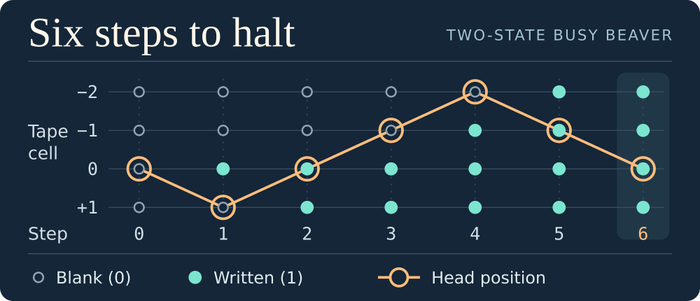

# Mathematical research notes

[**Wentao Li**](https://github.com/VictorLiwentao) · Prepared with assistance from **OpenAI GPT-6.2 Astra**

This collection contains **47 research drafts across eight fields**. Each note links to the question or gap in the literature and gives a proposed proof or counterexample in PDF and LaTeX. The arguments and their priority await independent review.

[Browse by field](#browse-the-collection) · [Scores and original questions](docs/scores-and-sources.md) · [Verification and citation](#verification-and-citation) · [Lean progress](lean/README.md)

## Selected questions

*This two-state machine halts after six steps, the longest halting run on a blank tape with two states and two symbols.*

- **Can two separate records share the power of Busy Beaver?** In 2020 Toby Ord asked whether the computational power of Busy Beaver could be split. Scott Aaronson asked for two functions whose upper bounds together decide halting while either alone is insufficient. The draft partitions the halting machines into two groups. At every state count, the larger of their two runtime records equals Busy Beaver. [Read the Busy Beaver note](results/computability/splitting-busy-beaver/)
- **How much choice is hidden in Rado’s selection lemma?** Yehuda Rav recorded the question in 1977. The draft argues that the lemma implies the Boolean prime ideal theorem in pure ZF. The reverse implication was already known. [Read the set theory note](results/set-theory/rado-prime-ideal/)
- **Can privacy force a learner to list every label?** In 2025 Steve Hanneke, Shay Moran, Hilla Schefler and Iska Tsubari asked whether two bounds suffice for private list learning. The draft constructs a class where both dimensions equal one and an ordinary online learner makes at most one mistake, yet privacy can require listing every label. [Read the learning theory note](results/learning-theory/private-list-learning-on-products/)

## Browse the collection

Expand a field to find its drafts, PDFs and original sources. Scores estimate mathematical significance on a 1–100 scale, with a full resolution of three-dimensional Navier–Stokes existence and smoothness at 100. The scoring index gives the reason for each rating and the history of each question. [Scores and attributions](docs/scores-and-sources.md)

### Computability

5 drafts · Busy Beaver records and computably enumerable sets

| Draft and source | Proposed result | Score |
| --- | --- | ---: |
| [Countable orders of strong settling times](results/computability/strong-settling-orders/) · [PDF](results/computability/strong-settling-orders/strong-settling-orders.pdf) [Csima and Shore, 2006](https://www.math.uwaterloo.ca/~csima/papers/settlingtime.pdf) | Every countable partial order has a representation by computably enumerable sets ordered both by strong settling-time domination and by Turing reducibility. The entire family can lie strictly below the halting problem. | 74 |
| [Splitting the Busy Beaver runtime](results/computability/splitting-busy-beaver/) · [PDF](results/computability/splitting-busy-beaver/splitting-busy-beaver.pdf) [Ord, 2020](https://scottaaronson.blog/?p=4916#comment-1851063) · [Aaronson’s formulation](https://scottaaronson.blog/?p=4916#comment-1851125) | The pointwise maximum of two runtime records is Busy Beaver. Each record eventually outgrows every computable function. An oracle for either record cannot compute an upper bound for the other. | 62 |
| [The Lazy Beaver runtime spectrum](results/computability/lazy-beaver-runtime-spectrum/) · [PDF](results/computability/lazy-beaver-runtime-spectrum/lazy-beaver-runtime-spectrum.pdf) [Scott Aaronson, 2020](https://doi.org/10.1145/3427361.3427369) | Even when a machine is tested on every initial tape, the number of distinct runtime profiles is exponentially smaller than the number of graphically accessible transition tables. This is a stronger bound than the one needed to refute the original conjecture. | 49 |
| [Advice between Busy Beaver records](results/computability/prefix-free-busy-beaver-advice/) · [PDF](results/computability/prefix-free-busy-beaver-advice/prefix-free-busy-beaver-advice.pdf) [Scott Aaronson, 2020](https://doi.org/10.1145/3427361.3427369) | For optimal prefix-free programs, constant advice suffices at every length. In the classical state-count model the one-step cost averages $\Theta(\log N)$ below $N$ states. | 60 |
| [Busy Beaver bouncer tapes](results/computability/bouncer-tape-inclusion/) · [PDF](results/computability/bouncer-tape-inclusion/bouncer-tape-inclusion.pdf) [Tristan Stérin, 2024](https://discuss.bbchallenge.org/t/186/1) · [Blanchard’s restrictions](https://discuss.bbchallenge.org/t/186/2) | An exact linear-time inclusion test for aligned tape formulas with separated repeaters and equal repeater counts. An empty-wall counterexample separates two proposed conditions. | 35 |

### Set theory

12 drafts · Choice, compactness and infinite graphs

| Draft and source | Proposed result | Score |
| --- | --- | ---: |
| [Cardinal comparability and choice at the first uncountable ordinal](results/set-theory/choice-at-omega-one/) · [PDF](results/set-theory/choice-at-omega-one/choice-at-omega-one.pdf) [Howard and Tachtsis, 2025](https://arxiv.org/abs/2410.18229v3) | In one model of ZF, every uncountable set contains a copy of ω₁, yet some ω₁-indexed family of finite sets has no choice function. | 74 |
| [The Erdős–Dushnik–Miller theorem and countable unions](results/set-theory/edm-countable-unions/) · [PDF](results/set-theory/edm-countable-unions/edm-countable-unions.pdf) [Howard and Tachtsis, 2025](https://arxiv.org/abs/2410.18229v3) | Both forms of the Erdős–Dushnik–Miller theorem studied here can hold while a countable union of countably infinite sets is uncountable in pure ZF. | 71 |
| [Uncountable partial choice and bounded countable families](results/set-theory/bounded-countable-choice/) · [PDF](results/set-theory/bounded-countable-choice/bounded-countable-choice.pdf) [Howard and Tachtsis, 2025](https://arxiv.org/abs/2410.18229v2) | If every uncountable family of nonempty finite sets admits choices on an uncountable subfamily, then every countable family of nonempty sets of uniformly bounded finite size has a choice function. | 63 |
| [Antichains in locally finite trees](results/set-theory/tree-antichain-choice/) · [PDF](results/set-theory/tree-antichain-choice/tree-antichain-choice.pdf) [Banerjee and Gopaulsingh, 2023](https://arxiv.org/abs/2211.05665v3) | Every uncountable locally finite rooted tree can have an uncountable antichain, even when a sequence of pairs has no choice function in pure ZF. | 64 (Q6.6) 44 (Q6.7) |
| [Rado selection and the Boolean prime ideal theorem](results/set-theory/rado-prime-ideal/) · [PDF](results/set-theory/rado-prime-ideal/rado-prime-ideal.pdf) [Yehuda Rav, 1977](https://doi.org/10.1002/mana.19770790112) · [Howard and Tachtsis, 2014](https://doi.org/10.1007/s00153-014-0390-y) | Over pure ZF, Rado’s selection lemma is equivalent to the Boolean prime ideal theorem. In the presence of atoms, the draft identifies exactly which additional ordering principle suffices. | 78 |
| [Ordered choice and two partition theorems](results/set-theory/ordered-choice-dilworth/) · [PDF](results/set-theory/ordered-choice-dilworth/ordered-choice-dilworth.pdf) [Eleftherios Tachtsis, 2019](https://doi.org/10.1007/s10474-019-00967-w) | Choice for linearly ordered families implies the finite-width Dilworth theorem in ZFA. The note also explains Tachtsis’s 2024 matching example. The score covers the Dilworth implication. | 61 |
| [When measurable Dilworth decompositions exist](results/set-theory/measurable-dilworth/) · [PDF](results/set-theory/measurable-dilworth/measurable-dilworth.pdf) [Bosek, Grytczuk and Lonc, 2020](https://arxiv.org/abs/2004.02162v1) | A measurable poset of width two can have every measurable chain null. For perfect measures, countable separation on a conull set characterizes the existence of the optimal partition. | 56 |
| [Promise reductions and partial assignments without finite choice](results/set-theory/ordered-partial-assignments/) · [PDF](results/set-theory/ordered-partial-assignments/ordered-partial-assignments.pdf) [Bertalan Bodor, 2026](https://arxiv.org/abs/2604.08365) | A common algebraic reduction between promise constraint problems gives an implication between their compactness principles in ZF, even on sets with no linear order. | 68 |
| [Integer weights and promise compactness](results/set-theory/promise-compactness/) · [PDF](results/set-theory/promise-compactness/promise-compactness.pdf) [Bertalan Bodor, 2026](https://arxiv.org/abs/2604.08365) | Local exact-one satisfiability can give global not-all-equal colorings without choice for pairs. In a second example, a symmetric operation coexists with compactness equivalent to the ultrafilter lemma. | 65 (Q6.3) 64 (Q6.5–6.6) |
| [Affine compactness and 2-SAT without choice](results/set-theory/affine-compactness/) · [PDF](results/set-theory/affine-compactness/affine-compactness.pdf) [Li, Shan, Snodgrass, Thornton and Zhou, 2026](https://arxiv.org/abs/2609.33873) | In one model of pure ZF, compactness holds for affine equations over all finite abelian groups and fails for 2-SAT. This completes the Boolean implication diagram. | 76 |
| [Hajnal’s product theorem without the ultrafilter lemma](results/set-theory/hajnal-products-without-choice/) · [PDF](results/set-theory/hajnal-products-without-choice/hajnal-products-without-choice.pdf) [Banerjee and Gyenis, 2019](https://arxiv.org/abs/1911.00434v1) | One model satisfies every finite-color product theorem while choice for pairs fails. In pure ZF with dependent choice, two countably chromatic graphs can have a bipartite product. | 70 |
| [Choice and distinguishing vertex colorings](results/set-theory/choice-and-distinguishing-colorings/) · [PDF](results/set-theory/choice-and-distinguishing-colorings/choice-and-distinguishing-colorings.pdf) [Banerjee, Molnár and Gopaulsingh, 2024](https://arxiv.org/abs/2408.00812v2) | Over ZF, the axiom of choice is equivalent to the existence of a distinguishing chromatic number for every infinite connected graph, even when restricted to rigid graphs. | 64 |

### Finite model theory

6 drafts · Logical limit laws, spectra and model counts

| Draft and source | Proposed result | Score |
| --- | --- | ---: |
| [A universal spectrum on planar graphs](results/finite-model-theory/universal-planar-spectrum/) · [PDF](results/finite-model-theory/universal-planar-spectrum/universal-planar-spectrum.pdf) [Durand, Jones, Makowsky and More, 2009](https://arxiv.org/abs/0907.5495v1) | A single first-order sentence about connected planar graphs of maximum degree three can represent every first-order spectrum. The reduction uses only equality on the input set. | 61 |
| [Which slow sequences count labelled finite models?](results/finite-model-theory/labelled-model-counts/) · [PDF](results/finite-model-theory/labelled-model-counts/labelled-model-counts.pdf) [Durand, Jones, Makowsky and More, 2009](https://arxiv.org/abs/0907.5495v1) | The sequence of primes cannot enumerate the labelled model counts of a sentence in a fixed finite relational language. Counts bounded by a fixed exponential eventually have an exact exponential-polynomial formula for both first-order and monadic second-order sentences. | 63 |
| [A zero-one law for two-connected graphs](results/finite-model-theory/two-connected-graph-zero-one-law/) · [PDF](results/finite-model-theory/two-connected-graph-zero-one-law/two-connected-graph-zero-one-law.pdf) [Heinig, Müller, Noy and Taraz, 2014](https://arxiv.org/abs/1401.7021v2) | For uniform labelled two-connected graphs in a proper 2-addable minor-closed class containing a cycle, every monadic second-order sentence converges exponentially to probability zero or one. The almost-sure theory is decidable exactly when the class has bounded treewidth. | 59 |
| [Three gaps in logical limit laws](results/finite-model-theory/three-gaps-in-graph-limit-laws/) · [PDF](results/finite-model-theory/three-gaps-in-graph-limit-laws/three-gaps-in-graph-limit-laws.pdf) [Heinig, Müller, Noy and Taraz, 2014](https://arxiv.org/abs/1401.7021v2) | In every proper addable minor-closed graph class, at least three gaps separate the attainable limiting probabilities. Forests attain the sharp generating-function bound. | 52 |
| [Labeled compositions and limiting probabilities](results/finite-model-theory/labeled-composition-limit-law/) · [PDF](results/finite-model-theory/labeled-composition-limit-law/labeled-composition-limit-law.pdf) [Braunfeld and Kukla, 2021](https://arxiv.org/abs/2111.06307v1) | On uniform labelled compositions, every monadic second-order sentence has an exponentially convergent probability. First-order sentences already attain the full set of limits. | 56 |
| [Failure of a first-order convergence law](results/finite-model-theory/permutation-limit-counterexample/) · [PDF](results/finite-model-theory/permutation-limit-counterexample/permutation-limit-counterexample.pdf) [Braunfeld and Kukla, 2021](https://arxiv.org/abs/2111.06307v1) | In a proper hereditary permutation class, the probability that the two orders share a least element tends to one along selected sizes and to zero at the immediately following sizes. | 60 |

### Learning theory

9 drafts · Privacy, language generation and online prediction

| Draft and source | Proposed result | Score |
| --- | --- | ---: |
| [Private generation on uncountable collections](results/learning-theory/private-generation-uncountable/) · [PDF](results/learning-theory/private-generation-uncountable/private-generation-uncountable.pdf) [Mehrotra, Velegkas, Yu and Zhou, 2026](https://arxiv.org/abs/2604.08504) | One observation suffices for ordinary uniform generation, yet pure privacy can drive worst-case eventual success to zero. For a second collection, optimal success equals the additive privacy allowance. | 66 |
| [Lists and finite partitions in uniform generation](results/learning-theory/uniform-list-generation/) · [PDF](results/learning-theory/uniform-list-generation/uniform-list-generation.pdf) [Charikar, Pabbaraju and Tewari, 2026](https://proceedings.mlr.press/v336/charikar26a.html) | Two guesses suffice after one example, yet every finite partition has a part that defeats single-word generation. A Ramsey construction gives the separation at every list length. | 54 |
| [A process criterion for multiclass online learning](results/learning-theory/universal-multiclass-processes/) · [PDF](results/learning-theory/universal-multiclass-processes/universal-multiclass-processes.pdf) [Hanneke and Wang, 2026](https://proceedings.mlr.press/v306/hanneke26b.html) | Weighted tests on shared histories characterize learning with infinitely many labels. On a fixed process, sparse corruptions can drive regret to one even when realizable mistakes grow arbitrarily slowly. | 67 |
| [Private language identification](results/learning-theory/private-language-identification/) · [PDF](results/learning-theory/private-language-identification/private-language-identification.pdf) [Mehrotra, Velegkas, Yu and Zhou, 2026](https://arxiv.org/abs/2604.08504) (gap between two theorems) | For a countable family of infinite languages presented without repetition, private identification is possible exactly when every two distinct languages share only finitely many words. | 64 |
| [Private list learning at both dimensions one](results/learning-theory/private-list-learning-on-products/) · [PDF](results/learning-theory/private-list-learning-on-products/private-list-learning-on-products.pdf) [Hanneke, Moran, Schefler and Tsubari, 2025](https://proceedings.mlr.press/v291/hanneke25d.html) | Both proposed dimensions can equal one and an online learner can make at most one mistake, yet a differentially private learner can still need every label in its list. | 72 |
| [Finite evidence for computable online learning](results/learning-theory/computable-online-learning-certificates/) · [PDF](results/learning-theory/computable-online-learning-certificates/computable-online-learning-certificates.pdf) [Kalociński and Steifer, 2025](https://arxiv.org/abs/2510.18352) | Finite evidence characterizes learnability for arbitrary classes and the exact uniform mistake budget. Finding a defeating stream can require computing a path through any prescribed recursive tree. | 58 |
| [An unbounded compactness gap for agnostic learning](results/learning-theory/agnostic-compactness-gap/) · [PDF](results/learning-theory/agnostic-compactness-gap/agnostic-compactness-gap.pdf) [Asilis, Devic, Dughmi, Sharan and Teng, 2024](https://proceedings.neurips.cc/paper_files/paper/2024/file/eb7295a8bc613b375726659c2ecd6f14-Paper-Conference.pdf) | Every finite projection has vanishing excess error at a common rate, yet the full class has excess error one at every sample size. The first possible density for this failure is $\aleph_\omega$. | 68 |
| [When the previous guess cannot remember a language](results/learning-theory/last-guess-identification/) · [PDF](results/learning-theory/last-guess-identification/last-guess-identification.pdf) [Kleinberg, Mehrotra, Saberi and Velegkas, 2026](https://arxiv.org/abs/2605.30324) | A nested family of regular languages with singleton telltales defeats every last-guess learner, even on repetition-free texts. One extra bit restores exact identification. | 39 |
| [The halting threshold for prompted language generation](results/learning-theory/prompted-generation-oracle/) · [PDF](results/learning-theory/prompted-generation-oracle/prompted-generation-oracle.pdf) [Kleinberg and Mullainathan, 2024](https://arxiv.org/abs/2404.06757v1) | Two polynomial-time-checkable languages already require a halting oracle for eventual prompt completion. A bound on answer length characterizes the countable families that admit a generator. | 63 |

### Graph theory

3 drafts · Random graphs, independence roots and surface map graphs

| Draft and source | Proposed result | Score |
| --- | --- | ---: |
| [Unbounded fragments in unlabelled random graphs](results/graph-theory/unlabelled-fragment-counterexample/) · [PDF](results/graph-theory/unlabelled-fragment-counterexample/unlabelled-fragment-counterexample.pdf) [Colin McDiarmid, 2020](https://arxiv.org/abs/2001.05256v1) | One bridge-addable class with finite exponential growth has nearly linear expected fragment size along a subsequence of graph orders. The same example contradicts both proposed bounds. | 62 |
| [Random graphs and independence roots](results/graph-theory/random-graph-independence-roots/) · [PDF](results/graph-theory/random-graph-independence-roots/random-graph-independence-roots.pdf) [Brown and Cameron, 2018](https://arxiv.org/abs/1802.02478v1) | For every fixed edge probability $0<p<1$, a root in the open right half-plane occurs with probability bounded away from zero along a subsequence. At $p=1/2$ the limit superior is at least $1-e^{-1/4}$. | 58 |
| [Map graphs on surfaces](results/graph-theory/surface-map-cliques/) · [PDF](results/graph-theory/surface-map-cliques/surface-map-cliques.pdf) [Dallard, Milanič, Munaro and Yang, 2025](https://arxiv.org/abs/2506.12424) | The worst-case clique-cover degeneracy on a surface of Euler genus $g$ grows as $\Theta(1+\sqrt{g})$. | 54 |

### Algebraic combinatorics

3 drafts · Roots and interlacing of counting polynomials

| Draft and source | Proposed result | Score |
| --- | --- | ---: |
| [Large-genus Hurwitz roots](results/algebraic-combinatorics/hurwitz-root-asymptotics/) · [PDF](results/algebraic-combinatorics/hurwitz-root-asymptotics/hurwitz-root-asymptotics.pdf) [Coulter, Do and Moskovsky, 2023](https://arxiv.org/abs/2308.04015v1) | For every fixed cycle profile, the first correction gives the direction and exponential rate at which each moving root approaches its limit. | 46 |
| [Parking-function excedances](results/algebraic-combinatorics/parking-excedances/) · [PDF](results/algebraic-combinatorics/parking-excedances/parking-excedances.pdf) [Per Alexandersson, 2026](https://www.symmetricfunctions.com/realRootedOpenProblems.htm#conjParkingExcedances) | An exact integer inequality certifies a nonreal root at size 17, settling the all-sizes conjecture. The coefficient formula applies at every size. | 29 |
| [Type-D Eulerian polynomials](results/algebraic-combinatorics/type-d-interlacing/) · [PDF](results/algebraic-combinatorics/type-d-interlacing/type-d-interlacing.pdf) [Chak-On Chow, 2022](https://doi.org/10.1016/j.jmaa.2022.126019) | For every $q>0$, the zeros at consecutive ranks strictly interlace from rank three onward. | 45 |

### Lattice paths

2 drafts · Peaks, runs and returns in Dyck paths

| Draft and source | Proposed result | Score |
| --- | --- | ---: |
| [Peaks in Fuss–Dyck paths](results/lattice-paths/fuss-dyck-peaks/) · [PDF](results/lattice-paths/fuss-dyck-peaks/fuss-dyck-peaks.pdf) [Per Alexandersson, 2023](https://www.symmetricfunctions.com/realRootedOpenProblems.htm#conjFussCatalanNNE) | Fixing the number of north steps and peaks fixes all zeros of the $NNE$ counting polynomial, with multiplicities, across all Fuss slopes. | 41 |
| [Runs and returns in rational Dyck paths](results/lattice-paths/rational-dyck-run-return/) · [PDF](results/lattice-paths/rational-dyck-run-return/rational-dyck-run-return.pdf) [Dai, Fu and Qiu, 2025](https://arxiv.org/abs/2503.20155) | A determinant formula counts paths with prescribed returns and either run statistic for every width at least the height. | 43 |

### Permutation patterns

7 drafts · Bounded jumps and overlapping pattern occurrences

#### Permutations with bounded adjacent jumps

| Draft and source | Proposed result | Score |
| --- | --- | ---: |
| [Fixed and growing jump radii](results/permutation-patterns/adjacent-jump-limit/) · [PDF](results/permutation-patterns/adjacent-jump-limit/adjacent-jump-limit.pdf) [Nathaniel Nadler, 2026](https://arxiv.org/abs/2610.02526) | For 123-avoiders, the fixed-radius growth deficit is asymptotic to $16\pi^2/m^2$. A Brownian excursion maximum gives the surviving fraction when the radius grows with length. | 55 |
| [An automaton for arbitrary forbidden patterns](results/permutation-patterns/bounded-jump-automaton/) · [PDF](results/permutation-patterns/bounded-jump-automaton/bounded-jump-automaton.pdf) [Nathaniel Nadler, 2026](https://arxiv.org/abs/2610.02526) | Every finite forbidden set has a finite-state counting algorithm and a rational generating function for each fixed jump bound. | 58 |

#### Regular permutation packings

Item numbers follow the authors’ list in §7. [Original questions](https://arxiv.org/html/2610.29846v1#S7)

| Draft and source | Proposed result | Score |
| --- | --- | ---: |
| Item 2 · [Factorization with variable overlaps](results/permutation-patterns/packing-factorization/) · [PDF](results/permutation-patterns/packing-factorization/packing-factorization.pdf) [Blitvić, Kammoun and Steingrímsson, 2026](https://arxiv.org/html/2610.29846v1#S7) | A finite criterion decides whether counts split at a designated overlap and gives a witness whenever they fail to split. | 42 |
| Item 5 · [Separators in packing posets](results/permutation-patterns/packing-separators/) · [PDF](results/permutation-patterns/packing-separators/packing-separators.pdf) [Blitvić, Kammoun and Steingrímsson, 2026](https://arxiv.org/html/2610.29846v1#S7) | At overlap $m$, the answer for any number of copies is determined by testing up to $6(m+1)+1$ copies. | 39 |
| Item 6 · [Catalan packing representatives](results/permutation-patterns/packing-catalan-lift/) · [PDF](results/permutation-patterns/packing-catalan-lift/packing-catalan-lift.pdf) [Blitvić, Kammoun and Steingrímsson, 2026](https://arxiv.org/html/2610.29846v1#S7) | A count-preserving lift gives Catalan representatives for every overlap $m\ge 3$ and length $K\ge 2m$. | 34 |
| Item 8 · [The universal packing cutoff](results/permutation-patterns/packing-cutoff/) · [PDF](results/permutation-patterns/packing-cutoff/packing-cutoff.pdf) [Blitvić, Kammoun and Steingrímsson, 2026](https://arxiv.org/html/2610.29846v1#S7) | Two patterns can have arbitrarily many initial packing counts in common and differ at the very next count. | 44 |
| Item 9 · [Integer powers as packing counts](results/permutation-patterns/packing-powers/) · [PDF](results/permutation-patterns/packing-powers/packing-powers.pdf) [Blitvić, Kammoun and Steingrímsson, 2026](https://arxiv.org/html/2610.29846v1#S7) | Every positive integer base occurs for infinitely many patterns with overlap two. | 36 |

## Expository notes

Two notes give alternative proofs of published results.

| Note | Earlier result |
| --- | --- |
| [Local regularizers and PAC learning](docs/expositions/affine-local-regularization/) | The note gives an affine proof of the separation Eric Hou proved using tournaments in July 2026. [Hou’s paper](https://arxiv.org/abs/2607.23449) |
| [Two countability principles for partial orders](docs/expositions/poset-countability/) | The note gives direct proofs of two results Eleftherios Tachtsis published in 2024. [Tachtsis’s paper](https://doi.org/10.1007/s00605-023-01933-z) |

## Verification and citation

**Python.** 39 of the 47 drafts include runnable checks. For example, the parking-function script reproduces the integer inequality that certifies the counterexample. Each note describes which part of its argument the code checks. [Run the checks or rebuild a PDF](docs/verification.md)

**Lean.** Current coverage is **0 of 47 main statements**. The index explains how partial and complete formalizations will be recorded. [Lean formalization index](lean/README.md)

**Citation.** Cite an individual draft under Wentao Li with the title from its PDF. On the note’s GitHub page, press **Y**, then copy the version-specific URL. Credit the source of the original question alongside the draft. [Collection citation](CITATION.cff) · [Archive of the ten original note paths](https://github.com/VictorLiwentao/solved-problems/tree/f5bcb6167a737e6a70c1965b3635db963adc792c)
