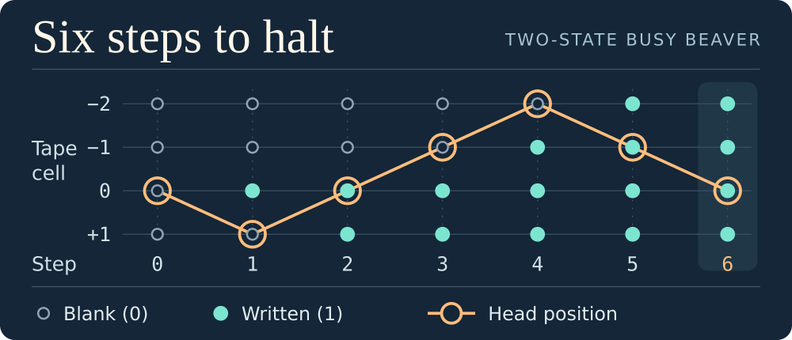

# Computability

[Browse by field](../../README.md#browse-the-collection) · [All drafts, A–Z](../README.md) · [Scores and original questions](../../docs/scores-and-sources.md#computability)

| Draft and source | Proposed result | Score / 100 |
| --- | --- | ---: |
| [Countable orders of strong settling times](strong-settling-orders/README.md) · [PDF](strong-settling-orders/strong-settling-orders.pdf) [Csima and Shore, 2006](https://www.math.uwaterloo.ca/~csima/papers/settlingtime.pdf) | Every countable partial order has a representation by computably enumerable sets ordered both by strong settling-time domination and by Turing reducibility. The entire family can lie strictly below the halting problem. | 74 |
| [Splitting the Busy Beaver runtime](splitting-busy-beaver/README.md) · [PDF](splitting-busy-beaver/splitting-busy-beaver.pdf) [Ord, 2020](https://scottaaronson.blog/?p=4916#comment-1851063) · [Aaronson’s formulation](https://scottaaronson.blog/?p=4916#comment-1851125) | The pointwise maximum of two runtime records is Busy Beaver. Each record eventually outgrows every computable function. An oracle for either record cannot compute an upper bound for the other. | 62 |
| [The Lazy Beaver runtime spectrum](lazy-beaver-runtime-spectrum/README.md) · [PDF](lazy-beaver-runtime-spectrum/lazy-beaver-runtime-spectrum.pdf) [Scott Aaronson, 2020](https://doi.org/10.1145/3427361.3427369) | Even when a machine is tested on every initial tape, the number of distinct runtime profiles is exponentially smaller than the number of graphically accessible transition tables. This is a stronger bound than the one needed to refute the original conjecture. | 49 |
| [Advice between Busy Beaver records](prefix-free-busy-beaver-advice/README.md) · [PDF](prefix-free-busy-beaver-advice/prefix-free-busy-beaver-advice.pdf) [Scott Aaronson, 2020](https://doi.org/10.1145/3427361.3427369) | For optimal prefix-free programs, constant advice suffices at every length. In the classical state-count model the one-step cost averages $\Theta(\log N)$ below $N$ states. | 60 |
| [Busy Beaver bouncer tapes](bouncer-tape-inclusion/README.md) · [PDF](bouncer-tape-inclusion/bouncer-tape-inclusion.pdf) [Tristan Stérin, 2024](https://discuss.bbchallenge.org/t/186/1) · [Blanchard’s restrictions](https://discuss.bbchallenge.org/t/186/2) | An exact linear-time inclusion test for aligned tape formulas with separated repeaters and equal repeater counts. An empty-wall counterexample separates two proposed conditions. | 35 |

## A two-state Busy Beaver

Starting on a blank tape, this two-state, two-symbol machine halts after six steps and leaves four ones. Six is the longest halting run for this machine size.
