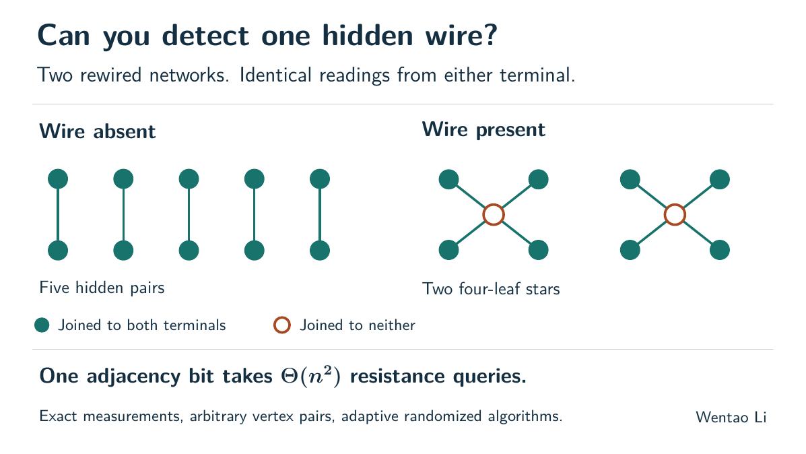

# One edge requires quadratically many effective-resistance queries

Wentao Li · November 2026 · Prepared with assistance from OpenAI GPT-6.2 Astra

Can you tell whether two specified points in a hidden network share a wire? One shortest-path reading answers the question. If you can measure only exact electrical resistance between chosen pairs of vertices, even a randomized strategy needs **Θ(n²) readings** in the worst case. This holds on sparse unweighted graphs of treewidth at most three, even with the edge count supplied.

[Proof (PDF)](resistance-adjacency.pdf) · [LaTeX](resistance-adjacency.tex) · [Exact checks](verify.py) · [Cite](citation.bib)

Huck Bennett, Mitchell Black, Amir Nayyeri and Evelyn Warton posed the tight-bound question after Theorem 28 of *Graph Inference with Effective Resistance Queries*. They proved a linear lower bound. Querying every pair gives a quadratic upper bound by reconstructing the full Laplacian. [ALT 2026 paper, §5](https://proceedings.mlr.press/v313/warton26a.html) · [2025 preprint](https://arxiv.org/abs/2502.18350)

## How to hide an edge

Start with a hidden perfect matching on $2m$ vertices. Join each vertex to both terminals. Rewire five matched pairs as two four-leaf stars, disconnect the two centers from the terminals, and insert the edge between the terminals. Both networks have $5m$ edges. In both, the resistance between the terminals is $1/m$, and the resistance from either terminal to *every* other vertex is $3/8+1/(4m)$.

The proof explains the coincidence by grounding both terminals. A matched pair and a four-leaf star give exactly the same inverse diagonal, $3/8$, at every interior vertex. For a measurement to change, **both** labels must belong to the ten rewired vertices. Even an adaptive algorithm looking for hidden matching edges needs quadratically many queries to hit the switch with constant probability.

The same examples also give a tight quadratic lower bound for **exact planarity** in this oracle model. The original network is planar. The rewired network contains a copy of $K_{3,4}$.

## Verification and priority

The Python script inverts whole grounded graph Laplacians over the rationals and checks every pair in 44 paired networks. The probability argument in the manuscript covers arbitrary orders and adaptive randomized algorithms. The draft awaits independent mathematical review and Lean formalization.

A search for subsequent work on designated-pair adjacency in the effective-resistance query model located the authors' preprint and conference paper. The classical quadratic lower bound for reconstructing a whole tree from distances has a different output requirement. No earlier resolution of the specified-edge question was located. [Reyzin and Srivastava, ALT 2007](https://doi.org/10.1007/978-3-540-75225-7_24)

**Significance estimate: 78/100.** The proof closes a linear-versus-quadratic gap for the simplest local adjacency decision and reaches the full-reconstruction query scale on sparse inputs. The result concerns a specific exact-measurement oracle. [Scoring scale](../../../docs/scores-and-sources.md)
