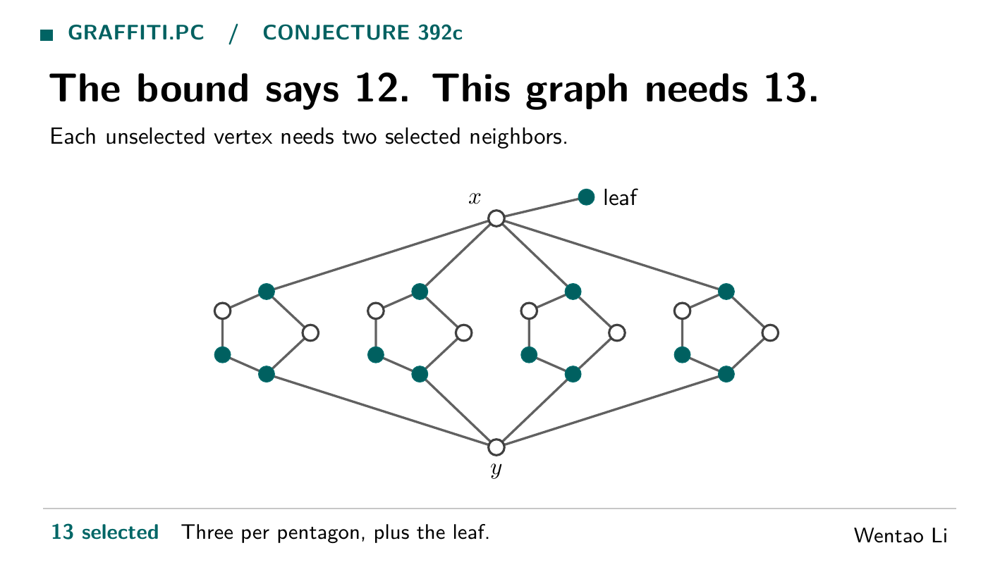

# Two matching bounds for double coverage

Wentao Li · November 2026 · Prepared with assistance from OpenAI GPT-6.2 Astra

Conjecture 392c predicts that 12 vertices suffice. On the pictured graph, 13 are necessary. The difference grows without bound even with one leaf and one cut vertex. Conjecture 392b, which counts vertices with one degree-two neighbor, holds in a stronger form.

[Proof (PDF)](two-domination-matching.pdf) · [LaTeX](two-domination-matching.tex) · [Exact checks](verify.py) · [Cite](citation.bib)

For a set of vertices to **2-dominate** a graph, each vertex outside the set must have at least two neighbors inside it. Write $\gamma_2$ for the smallest size of such a set and $\mu$ for the maximum size of a matching. All graphs below are finite, simple and undirected.

## The two questions

Ermelinda DeLaViña's Graffiti.pc listed 392b and 392c in January 2010. In a connected graph on more than two vertices, let $A$ be the minimum-degree vertices, $Q$ the degree-two vertices, and $T$ the vertices with exactly one neighbor in $Q$. Both proposals start with $|A|+\mu(G-A)$. Conjecture 392b adds $|T|$. Conjecture 392c adds the number of cut vertices. Both additions purport to give an upper bound for $\gamma_2$. The catalogue notes that 392c holds on trees. [Original catalogue, entries 392b–c](https://www.uhd.edu/academics/sciences/mathematics-statistics/wowii/index.html) · [Source statements](https://www.uhd.edu/academics/sciences/mathematics-statistics/wowii/files/conjectures.json)

## 392c is false

Take $k\ge2$ disjoint pentagons. In each one mark two nonadjacent vertices $u_i,v_i$. Join a new hub $x$ to every $u_i$, a second hub $y$ to every $v_i$, and a single leaf to $x$. There are no other edges.

The leaf is the unique minimum-degree vertex. The core without the leaf is 2-connected. Deleting a hub leaves all pentagons joined through the other hub. Deleting a pentagon vertex leaves a connected path in that block with at least one surviving attachment, and an intact block still joins the hubs. Thus $x$ is the sole cut vertex.

Every pentagon edge has an endpoint of degree two in the full graph, since its two marked vertices are nonadjacent. If both ends of an edge were omitted from a 2-dominating set, that degree-two endpoint would have at most one selected neighbor. The omitted vertices in each pentagon are therefore independent. At least three vertices from each pentagon and the leaf are required. Select the two marks and one endpoint of the edge between their two other neighbors. The two omitted vertices are then independent. Each hub sees at least two selected marks, and the leaf is included. Consequently $\gamma_2=3k+1$.

Without the leaf, a matching uses at most two hub edges and two internal edges per pentagon. This upper bound is attained. Match the hubs into different pentagons, perfectly match each of the two remaining four-vertex paths there, and take two edges in each other block. Hence $\mu(G-A)=2k+2$. The proposed upper bound is $2k+4$. Four pentagons give **13 required vertices against an upper bound of 12**. The deficit $k-3$ grows without bound although both correction parameters, the number of minimum-degree vertices and the number of cut vertices, stay at one.

## 392b is true

We first record a matching lemma. Let $F$ be a set of vertices kept permanently. Suppose the remaining vertices have two colors and every remaining vertex has at least two neighbors either in $F$ or of the opposite color. Then
$$\gamma_2(G)\le |F|+\mu(G-F).$$
Indeed, put $H=G-F$. By the Tutte–Berge formula there is $X\subseteq V(H)$ such that $\mu(H)=|X|+\sum_C\lfloor |C|/2\rfloor$, summed over the components of $H-X$. Keep $F$, $X$, and the smaller color class of each component (either in a tie). Every omitted vertex retains all its opposite-color neighbors in its component and every neighbor it has in $F\cup X$. The resulting set has the required size. This is the only matching theorem used.

Take $F=A\cup T$. We construct the coloring. A component of $G[Q]$ is a path, a singleton or a cycle. A cycle would be an entire connected graph of degree two, already contained in $A$. Both endpoints of each nonsingleton path belong to $T$. Alternate colors along the surviving interior segments. Each such vertex sees only its two path neighbors, both fixed or of the opposite color.

Color each surviving singleton of $G[Q]$ red. Color every remaining vertex outside $Q$ with a neighbor in $Q$ blue. A red singleton has two fixed or blue neighbors. A blue vertex has at least two neighbors in $Q$, since a vertex with just one belongs to $T$. Every one of these neighbors is a singleton or a path endpoint and thus is red or fixed. Finally color all still-uncolored vertices so as to maximize the number of edges of opposite colors among vertices outside $F$, keeping the earlier colors fixed. Such a vertex has degree at least three in $G$: leaves lie in $A$ and all degree-two vertices were handled. Flipping its color proves that at least half its nonfixed neighbors have the opposite color. Together with the fixed neighbors this gives at least two. This finishes the construction, including the case of an empty remainder.

The matching lemma now yields the stronger bound $\gamma_2(G)\le |A\cup T|+\mu(G-(A\cup T))$, which implies 392b by monotonicity of matching size.

## Verification, scope and priority

The verifier computes both invariants by exhaustive finite optimization on small graphs, checks 392b, and checks the pentagon witness separately. The 2-color argument and the family calculations establish the unrestricted statements. The broader subject and previously established matching bounds are discussed by DeLaViña, Larson, Pepper and Waller. The Tutte–Berge formula is classical. [Earlier 2-domination work](https://www.uhd.edu/documents/academics/sciences/gpcon2-dominmay17.pdf)

The original list records both entries as open. A search by statement and number in the literature, the DeepMind issue and pull-request lists, and public Graffiti research logs located no earlier resolution of these two entries. Independent review and Lean verification are pending.

The public logs used in the priority check include the [Graffiti verification archive](https://gitlab.com/ai-village-agents/village/graffiti-verification), the [archived conjecture worklog](https://gist.github.com/siddhantdubey/22f22a7a23db5174ee59e32eaa8724aa), and [DeepMind’s Formal Conjectures issues](https://github.com/google-deepmind/formal-conjectures/issues).

## Significance

392b earns 54 for a matching argument that converts a partial two-coloring to a 2-dominating set. 392c earns 52 for an explicit infinite family with unbounded error while the number of cuts stays fixed. [Scoring scale](../../../docs/scores-and-sources.md)
